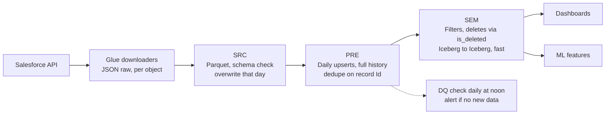
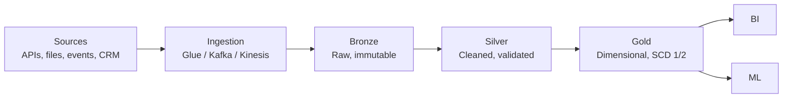

# Salesforce CRM Ingestion

Portfolio implementation based on production work experience. All data is synthetic, all code is original and clean-room, and no proprietary code, data, schema names, or internal system details from any employer are included.

## The problem

A wholesale CRM lives in Salesforce. Business teams need it fresh every day, with full history, deletes handled correctly, and no silent gaps after a failed run.

## Architecture — the actual design



### Before / after

**Before:** the calendar decided. A day-1 delta was used, SRC was appended with a full load every day, and a multi-day failure silently missed changes, forcing full reloads.

**After:** the data decides. For each table, read the latest timestamp already in the target (Athena MAX timestamp) with a small overlap, then load from that start date. Idempotent upserts make overlaps and replays safe, so the pipeline self-heals after outages.

### Layers

- **Raw:** Glue downloaders call the Salesforce API and land responses as JSON, per object (Account, Opportunity, Contact).
- **SRC:** a job converts JSON to Parquet after a schema check. SRC overwrites that day's load, it does not append a full load every day.
- **PRE:** daily upserts, full history preserved. SRC can carry duplicates, so SRC to PRE dedupes on record Id, keeping the latest timestamp, loading each unique Id once as a create or an update. That covers a straight re-fetch (same Id, same timestamp) and an update (same Id, newer timestamp).
- **SEM:** filters applied, deletes carried via an `is_deleted` field and applied at PRE to SEM promotion, so history is preserved in PRE and SEM reflects the current state. PRE to SEM is fast because it is Iceberg to Iceberg.
- **DQ:** a daily noon check reads the latest timestamp in the target and alerts if no new data arrived.

## Run

```bash
python -m src.generate_data
python -m src.download --object Account --out data/raw
python -m src.src_to_pre --src data/raw --pre data/pre
python -m src.pre_to_sem --pre data/pre --sem data/sem
python -m src.dq_check --target data/sem
python -m pytest tests/ -q
```

## Base platform architecture

This is the same blueprint every project in this profile starts from, covering all sources and both consumption paths (BI dashboards and ML features), unless a pipeline needs a specific change:


