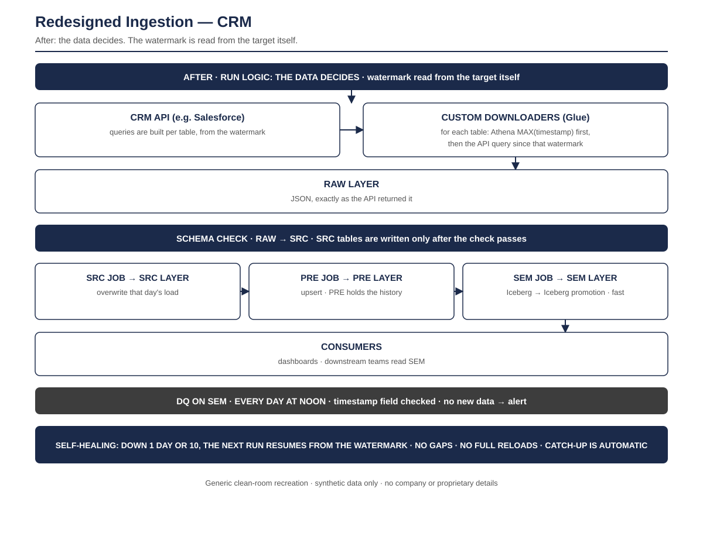
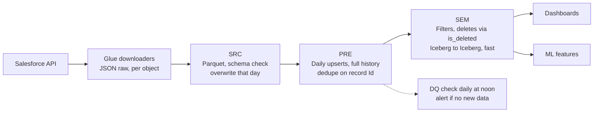
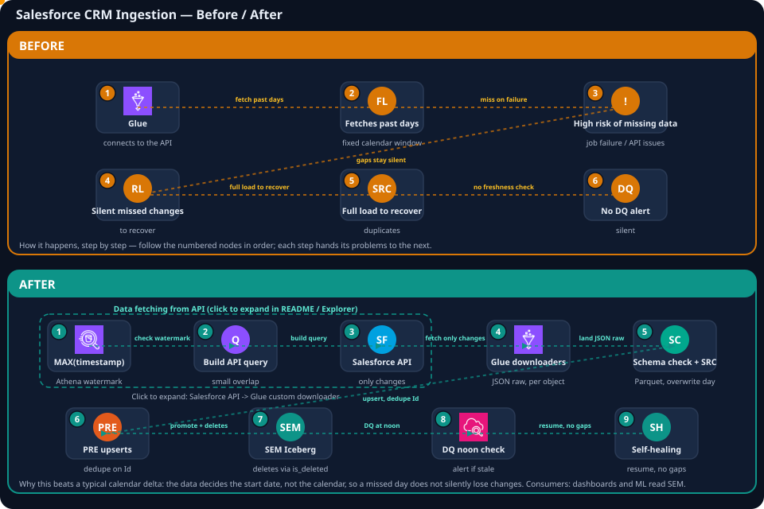
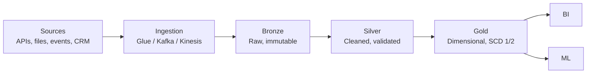

# Salesforce CRM Ingestion

Portfolio implementation based on production work experience. All data is synthetic, all code is original and clean-room, and no proprietary code, data, schema names, or internal system details from any employer are included.

## The problem

A wholesale CRM lives in Salesforce. Business teams need it fresh every day, with full history, deletes handled correctly, and no silent gaps after a failed run.

## Architecture — the actual design





### Before / after

Hover any component to see what it is and why it is needed.




**Before:** the calendar decided. A day-1 delta was used, SRC was appended with a full load every day, and a multi-day failure silently missed changes, forcing full reloads.

**After:** the data decides. For each table, read the latest timestamp already in the target (Athena MAX timestamp) with a small overlap, then load from that start date. Idempotent upserts make overlaps and replays safe, so the pipeline self-heals after outages.

<details>
<summary><b>Data fetching from API — click to expand the 3 steps</b></summary>

Steps 1-3 of the delta flow are all part of data fetching from API. Collapsed, this is just: Salesforce API -&gt; Glue custom downloader.

1. For each table, run Athena MAX(timestamp) on the target to get the watermark, the latest timestamp already loaded.
2. Build the Salesforce API query per table from that watermark, with a small overlap, so a change right on the boundary is not missed.
3. Call the Salesforce API with that query, fetching only changes since the watermark, not a full load.

</details>

The delta, step by step:

1. For each table, run Athena MAX(timestamp) on the target to get the watermark, the latest timestamp already loaded.
2. Build the Salesforce API query per table from that watermark, with a small overlap, so a change right on the boundary is not missed.
3. Call the Salesforce API with that query, fetching only changes since the watermark, not a full load.
4. Custom Glue downloaders call the API per object and land responses as JSON in the raw layer, exactly as the API returned them.
5. Schema check, then the SRC job writes Parquet, overwriting that day's load, so a re-run is safe and clean.
6. The PRE job upserts, deduping on record Id and keeping the latest timestamp, loading each Id once as a create or an update, with full history kept. Idempotent upserts make overlaps and replays safe.
7. The SEM job promotes PRE to SEM, Iceberg to Iceberg, fast, applying deletes via is_deleted, so SEM is current while PRE keeps history.
8. DQ check daily at noon on the timestamp field, alerting if no new data arrived.
9. Self-healing: if down 1 day or 10, the next run resumes from the watermark, no gaps, no full reloads.

Why this beats a typical calendar delta: the data decides the start date, not the calendar, so a missed day does not silently lose changes. A typical delta asks "what changed yesterday?", this one asks "what is the latest timestamp already in the target, and what changed since then?"

### Layers

- **Raw:** Glue downloaders call the Salesforce API and land responses as JSON, per object (Account, Opportunity, Contact).
- **SRC:** a job converts JSON to Parquet after a schema check. SRC overwrites that day's load, it does not append a full load every day.
- **PRE:** daily upserts, full history preserved. SRC can carry duplicates, so SRC to PRE dedupes on record Id, keeping the latest timestamp, loading each unique Id once as a create or an update. That covers a straight re-fetch (same Id, same timestamp) and an update (same Id, newer timestamp).
- **SEM:** filters applied, deletes carried via an `is_deleted` field and applied at PRE to SEM promotion, so history is preserved in PRE and SEM reflects the current state. PRE to SEM is fast because it is Iceberg to Iceberg.
- **DQ:** a daily noon check reads the latest timestamp in the target and alerts if no new data arrived.

## Setup

Requires Python 3.10+ and no other runtime dependencies besides PyYAML.

```bash
pip install -r requirements.txt   # pyyaml
```

Run the modules with `PYTHONPATH=src` from the repo root (shown below).
`pip install -e .` in a virtualenv additionally installs the `crm-*`
commands declared in `pyproject.toml`; on this machine's system Python,
user site-packages are disabled, so the `PYTHONPATH=src` form is the
reliable one.

Configuration lives in `config.yaml` (objects, layer paths, watermark overlap, DQ freshness window, retry settings). No credentials in the file: the real API is used only when `SF_INSTANCE_URL` and `SF_ACCESS_TOKEN` are both set in the environment. With neither set, the pipeline runs in offline mode against generated synthetic data, so the whole flow works locally with no account and no network.

## Run

Full pipeline locally (generates synthetic Accounts, downloads, promotes, DQ-checks):

```bash
PYTHONPATH=src python -m crm_ingestion.pipeline
```

Individual stages (each logs row counts: `rows_in`, `rows_out`, `rejected`, `created`, `updated`):

```bash
PYTHONPATH=src python -m crm_ingestion.generate_data --out data/synthetic
PYTHONPATH=src python -m crm_ingestion.download --object Account
PYTHONPATH=src python -m crm_ingestion.src_to_pre --object Account
PYTHONPATH=src python -m crm_ingestion.pre_to_sem --object Account
PYTHONPATH=src python -m crm_ingestion.dq_check --object Account
```

The DQ check is designed to be scheduled daily at noon, e.g.:

```cron
0 12 * * * cd /path/to/salesforce-crm-ingestion && PYTHONPATH=src python -m crm_ingestion.dq_check --object Account
```

It exits 0 when SEM is fresh and 2 with a `DQ ALERT` log line when SEM is empty or its latest timestamp is older than `dq_max_age_hours` (36h by default).

## How to test

```bash
pip install -e ".[dev]"   # pytest
PYTHONPATH=src python -m pytest tests/ -q
```

65 tests cover every module: record validation, watermark/SOQL building, API retries and backoff (including 429/5xx retry, auth failing fast, paging), schema validation and quarantine, dedupe/upsert counts, delete promotion, DQ freshness, the downloader's watermark use, and a full end-to-end pipeline run including a replay that must change nothing.

## Project structure

```
config.yaml                  # settings (no secrets); env vars for credentials
src/crm_ingestion/
  __init__.py
  config.py                  # Settings: YAML + env overrides, validated
  errors.py                  # exception hierarchy (schema, API, DQ, config)
  logging_config.py          # shared logging setup (logging, not print)
  models.py                  # CrmRecord: typed, validated, normalised
  watermark.py               # MAX(timestamp) + incremental SOQL builder
  api_client.py              # Salesforce client (retries/backoff/paging)
                             #   + SyntheticApiClient (offline stand-in)
  validate.py                # schema check + quarantine of bad records
  store.py                   # JSON layer I/O (one file per object)
  download.py                # watermark -> query -> fetch -> land raw
  src_to_pre.py              # dedupe on Id, upsert into PRE (full history)
  pre_to_sem.py              # apply deletes via is_deleted
  dq_check.py                # noon freshness check on the SEM target
  generate_data.py           # synthetic data generator (seeded, date-relative)
  pipeline.py                # end-to-end local runner
tests/                       # one test file per module
docs/                        # architecture diagrams
```

## Production habits in this code

- **Config separated from logic:** everything tunable lives in `config.yaml`; credentials come only from the environment, never from code or config.
- **Typed signatures and docstrings** on every public function.
- **Logging, not print:** every stage logs structured row counts (`rows_fetched`, `rows_valid`, `rows_rejected`, `created`, `updated`, `pre_after`, `deletes_applied`).
- **Explicit error handling:** a custom exception hierarchy (`SchemaValidationError`, `ApiError` / `ApiAuthError`, `WatermarkError`, `DqAlertError`, `ConfigError`) instead of bare exceptions.
- **Retries with backoff:** the API client retries 429/5xx and network errors with exponential backoff plus jitter, follows Salesforce query paging, and fails fast on auth errors.
- **Idempotency:** re-running a download or an upsert changes nothing (verified by the replay test); the watermark overlap makes boundary changes safe to re-load.
- **Data quality:** schema validation at ingest, null/duplicate handling in dedupe, bad records quarantined to `data/quarantine/*.jsonl` with the reason attached, never silently dropped.
- **No hardcoded paths or credentials:** paths come from config, tokens from the environment.

## Honest limitations (deliberately simple)

- **Local layers are JSON files, not Parquet/Iceberg.** The production design writes Parquet to S3 and Iceberg tables; locally the same record flow runs on JSON so it works with no Spark or Glue. Stage code depends only on record lists, not the format.
- **The watermark reads a local file.** In production it is an Athena `MAX(LastModifiedDate)` query over the target table; locally `watermark_from_file` computes the same maximum from the PRE file. The SOQL built from it is identical.
- **The synthetic generator covers Account only.** Opportunity and Contact are in `config.yaml` because the real pipeline handles them, but the offline demo generates Accounts; fetching another object offline fails with a clear error telling you to generate its data or configure the real API.
- **No real Salesforce credentials are bundled**, and no network call is made in offline mode. To run against a real org, set `SF_INSTANCE_URL` and `SF_ACCESS_TOKEN`.
- **All data is synthetic.** Names are `Account 1` … `Account 100`, amounts are random integers from a fixed seed, dates are relative to the run date. Nothing here is real customer data, and no numbers in this repo are presented as measured production metrics.

## Base platform architecture

This is the same blueprint every project in this profile starts from, covering all sources and both consumption paths (BI dashboards and ML features), unless a pipeline needs a specific change:


